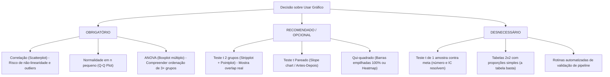

# Guia Definitivo de Testes Paramétricos
**Baseado na Aula 8 (`08-parametricos.qmd`) — Ciência de Dados**

---

## Sumário
1. [Visão Geral: O que torna um teste paramétrico?](#1-visão-geral-o-que-torna-um-teste-paramétrico)
2. [A Linha de Pensamento: As 3 Perguntas Decisivas](#2-a-linha-de-pensamento-as-3-perguntas-decisivas)
3. [Diagnóstico de Premissas: Normalidade e Homocedasticidade](#3-diagnóstico-de-premissas-normalidade-e-homocedasticidade)
4. [Casos Práticos da Aula: Quando usar, Retorno, Interpretação e Gráficos](#4-casos-práticos-da-aula)
   - [Caso 1: Teste t de Uma Amostra](#caso-1-teste-t-de-uma-amostra)
   - [Caso 2: Teste t de Welch (2 Amostras Independentes)](#caso-2-teste-t-de-welch-amostras-independentes)
   - [Caso 3: Teste t Pareado (Amostras Dependentes)](#caso-3-teste-t-pareado-amostras-dependentes)
   - [Caso 4: ANOVA One-Way + Teste Post-Hoc de Tukey](#caso-4-anova-one-way--teste-post-hoc-de-tukey)
   - [Caso 5: Correlação Linear de Pearson](#caso-5-correlação-linear-de-pearson)
   - [Caso 6: Teste Z de Duas Proporções](#caso-6-teste-z-de-duas-proporções)
   - [Caso 7: Teste Qui-Quadrado ($\chi^2$) de Independência](#caso-7-teste-qui-quadrado-chi2-de-independência)
5. [Quando Precisa de Gráfico ou Não? (Diretriz Visual)](#5-quando-precisa-de-gráfico-ou-não-diretriz-visual)
6. [Quadro-Resumo de Bolso: Guia Rápido de Decisão](#6-quadro-resumo-de-bolso-guia-rápido-de-decisão)

---

## 1. Visão Geral: O que torna um teste paramétrico?

Na inferência estatística, precisamos calcular a probabilidade de observar nossos dados sob a hipótese nula ($H_0$). Há dois grandes caminhos:
1. **Não Paramétrico / Computacional:** Simulações, permutações e reamostragens (bootstrap), sem assumir uma distribuição teórica fechada.
2. **Paramétrico:** Substitui a simulação computacional por uma **distribuição teórica de probabilidade** conhecida (como a distribuição Normal, $t$ de Student, $F$ de Snedecor ou $\chi^2$).

### A Lógica do Teste Paramétrico: Razão Sinal / Ruído
Praticamente todo teste paramétrico calcula uma estatística padronizada:
$$\text{Estatística} = \frac{\text{Sinal}}{\text{Ruído}} = \frac{\text{Efeito observado (diferença ou associação)}}{\text{Variabilidade esperada por mero acaso (Erro-Padrão)}}$$

- Se o **Sinal** for muito maior que o **Ruído**, a estatística cai nas caudas extremas da distribuição teórica.
- O **$p$-valor** mede a área sob a curva teórica além da estatística calculada: representa a chance de obter um resultado tão ou mais extremo quanto o observado caso $H_0$ fosse verdadeira.

---

## 2. A Linha de Pensamento: As 3 Perguntas Decisivas

Para não hesitar na escolha do teste, siga rigorosamente esta sequência de **três perguntas**:

```mermaid
flowchart TD
    Q1["1. Qual é o seu OBJETIVO?"] --> Q1A["Comparar Médias"]
    Q1 --> Q1B["Medir Associação"]
    Q1 --> Q1C["Comparar Proporções"]

    Q1A --> Q2A["2. Qual a Escala da Resposta?"]
    Q2A -->|Numérica Contínua| Q3A["3. Qual o Desenho Amostral?"]
    Q3A -->|1 Grupo vs. Meta| T1["Teste t de 1 Amostra"]
    Q3A -->|2 Grupos Independentes| T2["Teste t de Welch"]
    Q3A -->|2 Momentos no mesmo sujeito (Pareado)| T3["Teste t Pareado"]
    Q3A -->|3 ou mais Grupos Independentes| T4["ANOVA One-Way + Tukey HSD"]

    Q1B --> Q2B["2. Qual a Escala das Variáveis?"]
    Q2B -->|Numérica × Numérica| T5["Correlação de Pearson"]
    Q2B -->|Categórica × Categórica| T7["Qui-Quadrado de Independência"]

    Q1C --> Q2C["2. Quantos Grupos Binários?"]
    Q2C -->|2 Grupos Independentes| T6["Teste Z de 2 Proporções"]
    Q2C -->|Tabelas Maiores / >2 Grupos| T7
```

### Detalhamento das 3 Perguntas:
1. **Qual é o Objetivo?**
   - Comparar médias contra uma meta ou entre grupos?
   - Medir a associação/relação entre variáveis?
   - Comparar frequências ou proporções de eventos (sucesso/fracasso)?
2. **Qual é a Escala das Variáveis?**
   - **Quantitativa Contínua:** Permite médias, variâncias e distâncias reais (ex.: peso, consumo, tempo).
   - **Binária (Dicotômica):** Apenas 2 categorias (ex.: sobreviveu/morreu, sim/não).
   - **Nominal:** Múltiplas categorias sem ordem natural (ex.: espécie, porto de embarque).
   - **Ordinal:** Categorias com ordem, mas sem distância constante (ex.: nível de dor, classe social). *Atenção:* ordinais estritas demandam testes não paramétricos ou modelos ordinais.
3. **Qual é o Desenho Experimental?**
   - **Amostras Independentes:** Os indivíduos de um grupo não têm relação com os indivíduos dos outros grupos (ex.: machos vs. fêmeas).
   - **Amostras Pareadas (Dependentes):** As mesmas unidades amostrais são medidas em condições diferentes ou antes/depois (ex.: paciente antes e depois do remédio). *O pareamento remove a variação biológica individual.*

---

## 3. Diagnóstico de Premissas: Normalidade e Homocedasticidade

Antes de aplicar os testes, você deve validar se as premissas matemáticas se sustentam.

### 3.1 Normalidade: O que avaliar e quando?
A normalidade exige que a variável contínua (ou a diferença das médias / resíduos) venha de uma distribuição normal.

| Instrumento | Como funciona | O que retorna | Regra de Interpretação |
| :--- | :--- | :--- | :--- |
| **Q-Q Plot** (`probplot`) | Compara os quantis da amostra contra a reta teórica normal. | Visual (gráfico de dispersão com reta) | **Pontos na reta:** normal.<br>**Curva em U:** assimetria à direita.<br>**Forma de S:** caudas pesadas (outliers). |
| **Shapiro-Wilk** (`stats.shapiro`) | Teste formal de hipótese: $H_0$: distribuição é normal. | Estatística $W \in [0, 1]$ e $p$-valor | **$p > 0{,}05$:** Não rejeita normalidade (adequado).<br>**$p \le 0{,}05$:** Rejeita normalidade (não é normal). |

> **Armadilha do Tamanho da Amostra ($n$):**
> - Com **$n$ pequeno ($n < 30$)**: O teste de Shapiro tem pouco poder estatístico e pode não detectar desvios graves. Olhe obrigatoriamente o Q-Q Plot.
> - Com **$n$ grande ($n > 100$)**: Pelo **Teorema Central do Limite (TCL)**, a distribuição das médias amostrais aproxima-se da normal mesmo que os dados brutos não sejam estritamente normais. Além disso, o teste de Shapiro rejeita com facilidade desvios irrelevantes. Use o gráfico para bom senso.

### 3.2 Homocedasticidade: O que é?
Homocedasticidade significa **variâncias iguais entre os grupos** ($\sigma_1^2 = \sigma_2^2$).
- **Como testar:** Teste de Levene (`stats.levene`).
- **Interpretação:** Se $p \le 0{,}05$, as variâncias são estatisticamente diferentes (heterocedasticidade).
- **Impacto prático:** 
  - Para 2 grupos: use sempre o **Teste t de Welch** (`equal_var=False`), pois ele corrige automaticamente a heterocedasticidade sem perder poder quando as variâncias forem iguais.
  - Para 3+ grupos: a ANOVA clássica perde calibração de $\alpha$. A alternativa é a ANOVA de Welch ou testes não paramétricos.

---

## 4. Casos Práticos da Aula

A seguir, a análise detalhada dos 7 casos estudados na aula, organizados em formato modular para rápida consulta e geração de relatórios.

---

### Caso 1: Teste t de Uma Amostra

#### 1. Cenário e Hipóteses
- **Cenário (`mtcars`):** Uma frota deseja verificar se o consumo médio (`mpg`) de 32 carros atende a uma meta de projeto de $20\text{ mpg}$.
- **Hipótese Nula ($H_0$):** O consumo médio da população é igual à meta ($\mu = 20$).
- **Hipótese Alternativa ($H_1$):** O consumo médio é diferente da meta ($\mu \neq 20$).

#### 2. Quando Usar
- Resposta numérica contínua.
- Uma única amostra de dados independentes.
- Comparação contra uma constante ou meta pré-definida ($\mu_0$).

#### 3. Execução em Python & Retorno
```python
from scipy import stats

res = stats.ttest_1samp(mtcars["mpg"], popmean=20)
print(res.statistic, res.pvalue, res.df)
```
- **Retorno da Função:**
  - `statistic` ($t$): Número de erros-padrão que a média amostral se afasta da meta.
  - `pvalue` ($p$): Probabilidade bicaudal de observar um afastamento tão grande ou maior por mero acaso sob $H_0$.
  - `df`: Graus de liberdade ($n - 1$).

#### 4. Como Interpretar
- Se $p > 0{,}05$: Não há evidência suficiente para afirmar que a média difere da meta. Mantém-se o projeto como dentro do esperado.
- Se $p \le 0{,}05$: A média populacional difere significativamente da meta (analise o sinal do $t$ para saber se está acima ou abaixo).

#### 5. Quando Precisa de Gráfico?
- **Gráfico de Teste em si:** **Não é estritamente necessário.** Um resumo tabular com $\bar{x}$, desvio-padrão, valor de $t$ e intervalo de confiança 95% é suficiente.
- **Gráfico Recomendado (Diagnóstico):** Q-Q Plot ou Histograma caso $n < 30$, para validar se os dados não têm assimetria severa.

---

### Caso 2: Teste t de Welch (Amostras Independentes)

#### 1. Cenário e Hipóteses
- **Cenário (`penguins`):** Biólogos querem saber se machos e fêmeas possuem massas corporais médias distintas (dimorfismo sexual).
- **Hipótese Nula ($H_0$):** As médias populacionais dos dois grupos são iguais ($\mu_{\text{macho}} = \mu_{\text{fêmea}}$).
- **Hipótese Alternativa ($H_1$):** As médias são diferentes ($\mu_{\text{macho}} \neq \mu_{\text{fêmea}}$).

#### 2. Quando Usar
- Resposta numérica contínua.
- Variável explicativa binária (dois grupos independentes: indivíduos distintos em cada grupo).
- **Por que Welch e não Student padrão?** O teste $t$ clássico de Student exige variâncias rigorosamente iguais ($\sigma_1^2 = \sigma_2^2$). O teste de Welch **não assume igualdade de variâncias** e calcula graus de liberdade ajustados (Satterthwaite). É o padrão recomendado pela literatura moderna.

#### 3. Execução em Python & Retorno
```python
res = stats.ttest_ind(males, females, equal_var=False)  # Welch: equal_var=False
```
- **Retorno da Função:**
  - `statistic` ($t$): Diferença entre as médias amostrais dividida pelo erro-padrão combinado de Welch:
    $$SE_{\text{diff}} = \sqrt{\frac{s_1^2}{n_1} + \frac{s_2^2}{n_2}}$$
  - `pvalue` ($p$): Probabilidade de erro tipo I sob a distribuição nula ajustada.

#### 4. Como Interpretar
- Se $p < 0{,}001$: Rejeita-se categoricamente $H_0$. Há forte evidência estatística de diferença nas massas médias.
- **Atenção conceitual:** O teste compara **médias**, não indivíduos isolados. Pode haver sobreposição substancial entre as distribuições individuais (ex.: fêmeas pesadas maiores que machos leves) mesmo com $p < 0{,}001$.

#### 5. Quando Precisa de Gráfico?
- **Obrigatório / Altamente Recomendado:** 
  - **Gráfico:** `stripplot` sobreposto com `pointplot` (marcando as médias) ou um `boxplot` com dados sobrepostos.
  - **Motivo:** O teste de hipótese informa apenas se a diferença existe ($p$-valor), mas o gráfico revela a **magnitude do efeito, a dispersão real e a sobreposição dos grupos**.

---

### Caso 3: Teste t Pareado (Amostras Dependentes)

#### 1. Cenário e Hipóteses
- **Cenário (`sleep`):** Dez pacientes recebem dois soníferos diferentes em momentos distintos, medindo-se as horas extras de sono.
- **Hipótese Nula ($H_0$):** O efeito médio das diferenças intra-indivíduo é zero ($\mu_D = 0$).
- **Hipótese Alternativa ($H_1$):** Há diferença sistemática entre os tratamentos ($\mu_D \neq 0$).

#### 2. Quando Usar
- Resposta numérica contínua em **dados pareados**:
  - Medições do tipo "Antes vs. Depois" no mesmo sujeito.
  - Teste A vs. B aplicado nas mesmas unidades.
- **Vantagem estatística:** Ao calcular $D_i = X_{2i} - X_{1i}$, cancela-se a variação biológica de base entre os pacientes. Reduz-se drasticamente o erro-padrão residual, aumentando o poder estatístico.

#### 3. Execução em Python & Retorno
```python
# Dados no formato wide: duas colunas pareadas
res = stats.ttest_rel(sleep_wide["droga_2"], sleep_wide["droga_1"])
```
- **Retorno da Função:**
  - `statistic` ($t$): $\frac{\bar{D} - 0}{s_D / \sqrt{n}}$, onde $\bar{D}$ é a média das diferenças.
  - `pvalue` ($p$): Significância da diferença média de sono.

#### 4. Como Interpretar & Comparação Didática
- No teste pareado: $t = 4{,}06$ com $p = 0{,}0028 \le 0{,}05$ $\rightarrow$ **Rejeita $H_0$** (droga 2 é superior).
- Se rodássemos erroneamente como independente (`ttest_ind`): $t = 1{,}86$ com $p = 0{,}0792 > 0{,}05$ $\rightarrow$ **Falso Negativo (Erro Tipo II)**, pois a variação natural entre o sono dos pacientes inflaria o denominador.
- **Se a premissa de normalidade das diferenças falhar ($n$ pequeno):** Utiliza-se o **Teste dos Postos Sinalizados de Wilcoxon** (`stats.wilcoxon`).

#### 5. Quando Precisa de Gráfico?
- **Altamente Recomendado:** Gráfico de linhas "Antes $\rightarrow$ Depois" conectando os pares de cada indivíduo (*slope chart*) ou Q-Q Plot das diferenças $D_i$.
- **Motivo:** Permite visualizar se quase todos os sujeitos melhoraram ou se o resultado foi puxado por apenas um paciente atípico.

---

### Caso 4: ANOVA One-Way + Teste Post-Hoc de Tukey

#### 1. Cenário e Hipóteses
- **Cenário (`iris`):** Comparação do comprimento da sépala (`sepal_length`) entre três espécies distintas de flor (*setosa*, *versicolor*, *virginica*).
- **Hipótese Nula da ANOVA ($H_0$):** Todas as médias populacionais são iguais ($\mu_1 = \mu_2 = \mu_3$).
- **Hipótese Alternativa ($H_1$):** Ao menos uma espécie possui média diferente das demais.

#### 2. Quando Usar
- Resposta numérica contínua contra uma variável categórica com **3 ou mais grupos independentes**.
- **Por que não fazer múltiplos testes t?** 
  Se você fizer 3 comparações com $\alpha = 0{,}05$, a probabilidade de cometer ao menos um falso positivo infla:
  $$\alpha_{\text{global}} = 1 - (1 - 0{,}05)^3 \approx 14{,}3\%$$
  A ANOVA testa todos os grupos simultaneamente com $\alpha$ protegido.

#### 3. Execução em Python & Retorno
```python
# 1. Homocedasticidade prévia
stat_lev, p_lev = stats.levene(setosa, versicolor, virginica)

# 2. ANOVA Global
f_stat, p_anova = stats.f_oneway(setosa, versicolor, virginica)

# 3. Teste Post-Hoc (se p_anova <= 0.05)
tukey = stats.tukey_hsd(setosa, versicolor, virginica)
```
- **Retorno da ANOVA:**
  - `statistic` ($F$): Razão entre a Variância Entre Grupos (sinal do tratamento) e a Variância Dentro dos Grupos (ruído natural). Se $F \gg 1$, o efeito do grupo domina o ruído.
  - `pvalue`: Significância global.
- **Retorno do Tukey HSD:**
  - Tabela com todos os pares possíveis ($A \times B$), diferença de médias, intervalo de confiança ajustado e $p$-valor ajustado para comparações múltiplas.

#### 4. Como Interpretar
- A ANOVA informa **se** há diferença, mas é um "teste omnibus": **não diz onde está a diferença**.
- Se ANOVA indicar $p \le 0{,}05$, examina-se o **Tukey HSD**:
  - Cada par com $p < 0{,}05$ representa grupos comprovadamente diferentes.
  - Se o intervalo de confiança da diferença contiver o valor zero, o par não possui diferença estatística.

#### 5. Quando Precisa de Gráfico?
- **Obrigatório:** Boxplot lado a lado ou gráfico de intervalos de confiança das médias de Tukey.
- **Motivo:** Com 3 ou mais grupos, uma tabela de números torna-se cognitiva e visualmente pesada; o gráfico mostra instantaneamente a ordenação hierárquica dos grupos e a separação entre caixas.

---

### Caso 5: Correlação Linear de Pearson

#### 1. Cenário e Hipóteses
- **Cenário (`mtcars`):** Relação entre peso do veículo (`wt`) e rendimento de combustível (`mpg`).
- **Hipótese Nula ($H_0$):** Não há correlação linear populacional entre as duas variáveis ($\rho = 0$).
- **Hipótese Alternativa ($H_1$):** Há correlação linear entre as variáveis ($\rho \neq 0$).

#### 2. Quando Usar
- Duas variáveis numéricas contínuas.
- Relação estritamente linear (em linha reta).
- Ausência de outliers que distorçam a covariância.

#### 3. Execução em Python & Retorno
```python
r, p_val = stats.pearsonr(mtcars["wt"], mtcars["mpg"])
```
- **Retorno da Função:**
  - `statistic` ($r$): Coeficiente de correlação linear variando de $-1$ a $+1$.
    - $r > 0$: Relação positiva (ambas sobem juntas).
    - $r < 0$: Relação negativa (uma sobe, outra desce).
    - Régua prática: $|r| < 0{,}3$ (fraca); $0{,}3 \le |r| \le 0{,}5$ (moderada); $|r| > 0{,}5$ (forte).
  - `pvalue`: Probabilidade de obter esse $r$ caso $\rho$ fosse nulo.

#### 4. Como Interpretar & Cuidados Críticos
- $r = -0{,}87$ ($p < 0{,}001$): Associação linear negativa e forte.
- **Atenção:** Correlação não implica causalidade.
- **Linearização:** Se a relação for curva (ex.: potência `hp` vs. `mpg`), o coeficiente de Pearson clássico subestima a associação. Aplica-se transformação matemática (ex.: $\log(x)$) ou utiliza-se o coeficiente não paramétrico de **Spearman**.

#### 5. Quando Precisa de Gráfico?
- **TOTALMENTE OBRIGATÓRIO (Condição *sine qua non*):**
  - **Gráfico:** Gráfico de dispersão (*scatterplot*) com reta de tendência (`sns.regplot`).
  - **Motivo:** O coeficiente de Pearson é "cego" à forma. Relações em "U", distribuições em arco ou o famoso *Quarteto de Anscombe* podem ter $r \approx 0$ mesmo havendo relação determinística perfeita, ou $r$ alto causado por um único outlier extremo. **Nunca reporte correlação sem ver o gráfico.**

---

### Caso 6: Teste Z de Duas Proporções

#### 1. Cenário e Hipóteses
- **Cenário (`titanic`):** Comparação da taxa de sobrevivência entre mulheres ($233/314 = 74{,}2\%$) e homens ($109/577 = 18{,}9\%$).
- **Hipótese Nula ($H_0$):** A proporção de sobrevivência é idêntica em ambos os sexos ($p_1 = p_2$).
- **Hipótese Alternativa ($H_1$):** As proporções diferem ($p_1 \neq p_2$).

#### 2. Quando Usar
- Variável resposta **binária** (sobreviveu: sim/não).
- Variável explicativa **binária** (dois grupos independentes).
- **Regra de Amostra Grande:** Mínimo de 5 sucessos e 5 fracassos em cada célula ($n\hat{p} \ge 5$ e $n(1-\hat{p}) \ge 5$). Se não for atendida, deve-se usar o **Teste Exato de Fisher**.

#### 3. Execução em Python & Retorno
```python
from statsmodels.stats.proportion import proportions_ztest, proportion_confint

# contagens = [sucessos_g1, sucessos_g2], n_obs = [n_g1, n_g2]
z_stat, p_val = proportions_ztest(contagens, n_obs)
low, high = proportion_confint(contagens, n_obs)
```
- **Retorno da Função:**
  - `z_stat` ($Z$): Quantos desvios-padrão a diferença entre as duas proporções amostrais está distante de zero.
  - `p_val`: Significância estatística associada à curva Normal padrão.
  - `low, high`: Limites do Intervalo de Confiança para a proporção de cada grupo.

#### 4. Como Interprerar
- Se $|Z| = 16{,}22$ e $p < 0{,}001$: Rejeita-se com folga $H_0$. Mulheres tiveram uma probabilidade de sobreviver estatisticamente e praticamente muito superior à dos homens.
- A não sobreposição dos intervalos de confiança de 95% confirma a enorme magnitude do efeito.

#### 5. Quando Precisa de Gráfico?
- **Opcional / Gráfico de Barras Percentual:**
  - Gráfico de barras com as porcentagens observadas e barras de erro de IC 95% é útil em apresentações executivas.
  - Em textos acadêmicos curtos, a tabela descritiva de contingência ($2 \times 2$) com percentuais e os valores de $Z$ e $p$ já cumprem o papel.

---

### Caso 7: Teste Qui-Quadrado ($\chi^2$) de Independência

#### 1. Cenário e Hipóteses
- **Cenário (`titanic`):** Verificar se a sobrevivência do passageiro está associada à classe da cabine (1ª, 2ª ou 3ª classe).
- **Hipótese Nula ($H_0$):** As variáveis são independentes (a chance de sobrevivência não depende da classe).
- **Hipótese Alternativa ($H_1$):** As variáveis são dependentes / associadas.

#### 2. Quando Usar
- Duas variáveis **categóricas** (nominais ou ordinais em tabelas $r \times c$).
- É a generalização do teste de proporções para tabelas maiores que $2 \times 2$.
- **Premissa das Frequências Esperadas:** Nenhuma célula esperada com $E < 1$ e no máximo $20\%$ das células com $E < 5$.

#### 3. Execução em Python & Retorno
```python
# Tabela de contingência observada (crosstab)
observed = pd.crosstab(titanic["pclass"], titanic["survived"])

chi2, p_val, gl, expected_arr = stats.chi2_contingency(observed)
```
- **Retorno da Função:**
  - `chi2` ($\chi^2$): A soma ponderada dos desvios entre observado e esperado:
    $$\chi^2 = \sum \frac{(O - E)^2}{E}$$
  - `p_val`: Significância estatística contra a distribuição qui-quadrado teórica.
  - `gl`: Graus de liberdade, calculados como $(\text{linhas} - 1) \times (\text{colunas} - 1)$.
  - `expected_arr`: Matriz das frequências que seriam esperadas se $H_0$ fosse rigorosamente verdadeira.

#### 4. Como Interpretar
- $\chi^2 = 102{,}89$, $\text{gl} = 2$, $p < 0{,}001$: Rejeita-se a independência. Sobrevivência e classe estão associadas.
- **Análise dos Resíduos:** Subtraia o Esperado do Observado ($(O - E)$):
  - Na 1ª classe, sobreviveram 136 pessoas (esperado era 83 $\rightarrow$ excesso positivo de sobreviventes).
  - Na 3ª classe, sobreviveram 119 pessoas (esperado era 188 $\rightarrow$ grande déficit de sobreviventes).

#### 5. Quando Precisa de Gráfico?
- **Recomendado:** Gráfico de barras empilhadas 100% (mostrando a proporção de sobreviventes por classe) ou um *Heatmap* da matriz de resíduos padronizados.
- **Motivo:** O teste diz que há dependência, mas o gráfico evidencia em qual classe ocorreu a maior discrepância.

---

## 5. Quando Precisa de Gráfico ou Não? (Diretriz Visual)

Em relatórios e publicações, gráficos ocupam espaço. Saber quando um gráfico é **obrigatório**, **opcional** ou **desnecessário** economiza tempo e melhora a clareza.



### Resumo por Teste:

| Teste | Necessidade de Gráfico | Gráfico Indicado | O que o gráfico mostra que o número esconde? |
| :--- | :---: | :--- | :--- |
| **Normalidade (Diagnóstico)** | **Obrigatório** | Q-Q Plot (`stats.probplot`) | Mostra *como* os dados fogem da curva (curva em U, forma de S, degrau). |
| **Teste t (1 Amostra)** | **Desnecessário** | - | É apenas um número contra uma meta. Basta reportar $\bar{x}$, $t$ e IC 95%. |
| **Teste t de Welch (2 Grupos)** | **Recomendado** | `stripplot` com ponto de média ou `boxplot` | Revela se a rejeição de $H_0$ tem relevância prática e a sobreposição dos grupos. |
| **Teste t Pareado** | **Recomendado** | *Slope chart* (linhas ligando o par) | Mostra se a mudança foi uniforme entre indivíduos ou puxada por anomalias. |
| **ANOVA + Tukey** | **Obrigatório** | `boxplot` com grupos ordenados | Identifica visualmente quais clusters de grupos se separam. |
| **Correlação de Pearson** | **OBRIGATÓRIO** | Dispersão + Reta (`regplot`) | Evita o erro de assumir linearidade em dados curvos ou iludidos por outliers. |
| **Teste Z (2 Proporções)** | **Opcional** | Barras percentuais com barra de erro | Útil para comunicação visual/executiva, redundante para estatísticos. |
| **Qui-Quadrado ($\chi^2$)** | **Recomendado** | Barras 100% empilhadas ou Heatmap | Permite identificar imediatamente as células que mais contribuíram para o desvio. |

---

## 6. Quadro-Resumo de Bolso: Guia Rápido de Decisão

Consulte esta tabela antes de escrever qualquer código ou responder a exames:

| Objetivo Principal | Resposta ($Y$) | Explicativa ($X$) / Desenho | Teste Indicado | Função Python | Se violar premissas, usar... |
| :--- | :--- | :--- | :--- | :--- | :--- |
| **Média contra meta fixa** | Contínua | Nenhuma (compara com $\mu_0$) | **$t$ de 1 amostra** | `stats.ttest_1samp` | Teste dos Postos Sinalizados de Wilcoxon |
| **Comparar médias de 2 grupos** | Contínua | Categórica (2 grupos independentes) | **$t$ de Welch** | `stats.ttest_ind(..., equal_var=False)` | Teste de Mann-Whitney (U) |
| **Comparar médias pareadas** | Contínua | 2 momentos / mesmo sujeito | **$t$ Pareado** | `stats.ttest_rel` | Teste de Wilcoxon pareado |
| **Comparar médias de 3+ grupos** | Contínua | Categórica (3+ grupos independentes) | **ANOVA One-Way + Tukey** | `stats.f_oneway` + `stats.tukey_hsd` | Kruskal-Wallis + Dunn |
| **Associação linear contínua** | Contínua | Contínua | **Pearson ($r$)** | `stats.pearsonr` | Correlação de Spearman ($r_s$) |
| **Comparar proporções de 2 grupos** | Binária | Categórica (2 grupos independentes) | **Teste Z de Proporções** | `proportions_ztest` | Teste Exato de Fisher |
| **Associação entre categorias** | Nominal | Nominal (tabelas $r \times c$) | **Qui-Quadrado ($\chi^2$)** | `stats.chi2_contingency` | Teste Exato de Fisher |

---

### Regra de Ouro da Tomada de Decisão:
1. **$p$-valor $\le 0{,}05$:** Rejeitamos a hipótese nula $H_0$. Há evidência estatisticamente significativa do efeito/diferença.
2. **$p$-valor $> 0{,}05$:** Não rejeitamos $H_0$. Os dados observados são compatíveis com a aleatoriedade (ausência de evidência não é evidência de ausência).
3. **Sempre avalie o Tamanho do Efeito:** Um $p$-valor minúsculo em uma amostra gigante pode representar uma diferença trivial sem relevância prática no mundo real.
