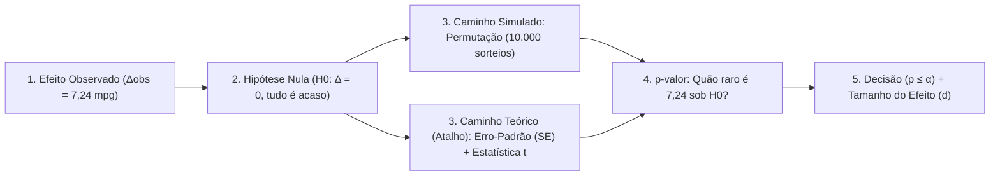

# Guia de Estudo e Síntese: Estatística Inferencial com `mtcars`

Este material conecta cada passo que você escreveu em [07-inferencia.qmd](file:///home/gabriel/Progs/ciencia-de-dados/praticas/Unidade_02/07-inferencia.qmd) com a teoria da [Aula 7](file:///home/gabriel/Progs/ciencia-de-dados/praticas/aulas/07-inferencia-estatistica.html), explicando **por que cada métrica existe**, **qual problema ela resolve** e **como aprimorar o seu notebook**.

---

## 1. O Fio Condutor: Por que não basta olhar para $\Delta_{obs} = 7,24\text{ mpg}$?

Na sua amostra de 32 carros (`mtcars`), os manuais fazem em média **7,24 mpg a mais** que os automáticos ($\Delta_{obs} = \bar{x}_{\text{manual}} - \bar{x}_{\text{auto}}$).

Mas a amostra é pequena (13 manuais e 19 automáticos). Se a revista *Motor Trend* tivesse sorteado outros 32 carros naquele ano, a diferença certamente não seria exatamente 7,24. **A pergunta central da inferência é:**
> *"Essa diferença de 7,24 mpg reflete um efeito real no mundo, ou o puro acaso (sorteio da amostra) conseguiria produzir uma diferença desse tamanho mesmo que câmbio manual e automático consumissem a mesma coisa?"*



---

## 2. O "Porquê" de Cada Conceito

### A. Hipótese Nula ($H_0$) e Permutação — *Para que servem?*
* **O que é $H_0$:** É o "advogado do diabo" (presunção de inocência). Supomos que **não há efeito** ($\mu_{\text{manual}} = \mu_{\text{auto}}$).
* **Por que assumimos $H_0$?** Porque dizer "há diferença" ($\Delta \neq 0$) é vago (pode ser 1, 5, 20 mpg), mas dizer "a diferença verdadeira é zero" ($\Delta = 0$) nos dá um cenário exato para testar.
* **Por que permutar (embaralhar)?** Se o câmbio não importa ($H_0$), os 32 valores de `mpg` vieram do mesmo lugar e as etiquetas `"manual"` e `"automatico"` foram coladas ao acaso. Ao embaralhar as etiquetas 10.000 vezes ([`permutation_null`](file:///home/gabriel/Progs/ciencia-de-dados/praticas/Unidade_02/07-inferencia.qmd#L91-L97)), você descobre **quais diferenças o acaso consegue fabricar sozinho** (no `mtcars`, o acaso quase sempre gera diferenças entre $-4$ e $+4$ mpg).

---

### B. Erro-Padrão ($SE$ — *Standard Error*) — *O que é e para que serve?*
* **Para que serve:** É a **"régua do acaso"**. Ele mede a largura da distribuição nula — ou seja, **quanto a diferença entre duas médias oscila de uma amostra para outra apenas por sorteio**, sem precisar rodar 10.000 simulações.
* **Qual a diferença entre Desvio-Padrão ($s$) e Erro-Padrão ($SE$)?**

| Medida | O que mede? | O que acontece se aumentarmos a amostra ($n$)? |
| :--- | :--- | :--- |
| **Desvio-Padrão ($s$)** | A dispersão dos **carros individuais** em relação à média. | **Não diminui.** Carros continuam sendo diferentes uns dos outros. |
| **Erro-Padrão ($SE$)** | A oscilação da **média (ou diferença de médias)** caso repetíssemos a pesquisa. | **Diminui** com $\sqrt{n}$. Quanto mais carros você mede, mais cravada e estável fica a média. |

* **Por que você calculou dois $SE$ diferentes no notebook?**
  1. **`se_null` ($2,17\text{ mpg}$):** Usa o desvio-padrão de todos os 32 carros misturados:
     $$SE_{\text{nulo}} = s_{\text{total}} \sqrt{\frac{1}{n_A} + \frac{1}{n_B}}$$
     Ele reproduz exatamente o desvio-padrão do histograma das 10.000 permutações (`mpg_null.std() == 2.16`). Porém, misturar dois grupos que têm médias muito distantes infla o desvio-padrão total artificialmente.
  2. **`se_welch` ($1,92\text{ mpg}$):** Mede a oscilação usando a variância **dentro de cada grupo separadamente**:
     $$SE_{\text{Welch}} = \sqrt{\frac{s_{\text{manual}}^2}{n_{\text{manual}}} + \frac{s_{\text{auto}}^2}{n_{\text{auto}}}}$$
     Como vimos na sua tabela descritiva ([linhas 30-35](file:///home/gabriel/Progs/ciencia-de-dados/praticas/Unidade_02/07-inferencia.qmd#L30-L35)), os manuais variam 60% a mais que os automáticos ($s = 6,17$ vs. $s = 3,83$) e têm tamanhos diferentes ($13$ vs. $19$). Por isso, o $SE$ de Welch é a régua mais justa!

---

### C. Estatística $t$ — *O que é e por que dividir $\Delta_{obs}$ pelo $SE$?*
$$t = \frac{\bar{x}_{\text{manual}} - \bar{x}_{\text{auto}}}{SE} = \frac{\Delta_{obs}}{SE}$$

* **O que ela responde:** *"Quantos erros-padrão (quantas 'réguas do acaso') cabem dentro da diferença que eu observei?"*
* **Para que serve:**
  1. **Remove a unidade de medida:** Dizer "7,24 mpg" exige entender de carros; dizer "$t = 3,77$" significa que a diferença observada é **3,77 vezes maior do que a oscilação típica do acaso**.
  2. **Dá um critério universal:** Sob o acaso ($H_0$), a estatística $t$ fica entre $-2$ e $+2$ em cerca de 95% das vezes. Qualquer $|t| > 2$ (em amostras razoáveis) já começa a ser suspeito; um $t = 3,77$ está muito longe do centro.

---

### D. Teste $t$ (de Student / Welch) — *Por que usar se já temos a permutação?*
O Teste $t$ ([`stats.ttest_ind(manual, automatic, equal_var=False)`](file:///home/gabriel/Progs/ciencia-de-dados/praticas/Unidade_02/07-inferencia.qmd#L203)) é o **atalho paramétrico**:
* **Por que usar o Teste $t$?**
  * **Velocidade instantânea:** Não precisa embaralhar dados 10.000 vezes; usa a fórmula matemática da distribuição $t$ para achar a área nas caudas ($p$-valor).
  * **Graus de Liberdade ($df = 18,33$):** Como nossa amostra é pequena (32 carros) e o próprio $SE$ foi estimado dos dados (podendo ter erro), o teste $t$ usa uma curva em forma de sino com **caudas mais pesadas** que a curva Normal. Isso evita falsos positivos em amostras pequenas.
* **Por que usar `equal_var=False` (Teste $t$ de Welch)?**
  * O teste $t$ clássico (`equal_var=True`) exige que os dois grupos tenham a mesma variância. No `mtcars`, $6,17 \neq 3,83$. A versão de Welch (`equal_var=False`) não exige variâncias iguais e deve ser o seu padrão na prática.
* **Quando o Teste $t$ falha (e a Permutação vence)?**
  * O teste $t$ depende de **média** e **desvio-padrão**. Se houver **um único outlier** (como um erro de digitação de `60 mpg` nos automáticos, mostrado na Seção 5.5 da aula), a média sobe, o $SE$ explode, o $t$ cai de $3,77$ para $1,78$ e o teste $t$ **para de funcionar** ($p = 0,085$). Já a permutação permite usar a **diferença de medianas**, que ignora o outlier!

> [!IMPORTANT]
> **Resumo de bolso:**
> * **$\Delta_{obs}$ (Sinal):** Tamanho bruto da diferença na amostra ($7,24\text{ mpg}$).
> * **$SE$ (Ruído):** Quanto a diferença de médias oscila por puro sorteio ($1,92\text{ mpg}$).
> * **Estatística $t$ (Sinal / Ruído):** Razão entre o efeito e o acaso ($7,24 / 1,92 = 3,77$).
> * **$p$-valor:** Probabilidade de ver um $|t| \geq 3,77$ se $H_0$ fosse verdadeira ($0,0014$, ou $0,14\%$).

---

## 3. Como Melhorar a Sua Prática em `07-inferencia.qmd`

Analisando o seu arquivo [07-inferencia.qmd](file:///home/gabriel/Progs/ciencia-de-dados/praticas/Unidade_02/07-inferencia.qmd) linha a linha em comparação com [07-inferencia-estatistica.html](file:///home/gabriel/Progs/ciencia-de-dados/praticas/aulas/07-inferencia-estatistica.html), aqui estão os ajustes de código e as análises do `mtcars` que faltam para deixar seu estudo completo:

### 3.1 Correções no código que você já escreveu
1. **Evite arredondar `delta_obs` na variável ([linha 48](file:///home/gabriel/Progs/ciencia-de-dados/praticas/Unidade_02/07-inferencia.qmd#L48)):**
   * Você fez `delta_obs = round(manual.mean() - automatic.mean(), 2)`. Isso salva `7.24` truncado em vez de `7.244939...`, gerando pequenas diferenças nos cálculos seguintes (`t_stat` e `se_welch`). Guarde o valor exato na variável e use `round(delta_obs, 2)` apenas ao exibir.
2. **Garanta teste bilateral com `abs(delta_obs)` ([linha 105](file:///home/gabriel/Progs/ciencia-de-dados/praticas/Unidade_02/07-inferencia.qmd#L105)):**
   * Use `mpg_p = np.mean(np.abs(mpg_null) >= abs(delta_obs))` (e corrija o typo `mgp_p` $\rightarrow$ `mpg_p`). Se um dia `delta_obs` for negativo, faltar o `abs()` na direita fará a comparação dar `1.0`!
3. **Ajuste no Boxplot + Stripplot ([linhas 60-72](file:///home/gabriel/Progs/ciencia-de-dados/praticas/Unidade_02/07-inferencia.qmd#L60-L72)):**
   * Adicione `showfliers=False` no `sns.boxplot` (caso contrário, se houver um outlier, o boxplot e o stripplot vão desenhá-lo duplicado) e passe `ax=ax` no `sns.stripplot`.
4. **Remova a duplicação de `se_welch` ([linhas 191-196](file:///home/gabriel/Progs/ciencia-de-dados/praticas/Unidade_02/07-inferencia.qmd#L191-L196)) e as células vazias ([linhas 208-272](file:///home/gabriel/Progs/ciencia-de-dados/praticas/Unidade_02/07-inferencia.qmd#L208-L272)).**

### 3.2 Etapas da aula sobre o `mtcars` que faltam adicionar ao seu notebook
Você parou na linha 205 (logo após rodar `stats.ttest_ind`). Para fechar o ciclo da Aula 7 usando apenas o `mtcars` (e já resolvendo o Exercício 1 do *Para Casa*), adicione estas 3 seções:

#### Passo A: Testar a fragilidade do Teste $t$ com 1 valor atípico (Seção 5.5 da aula)
Adicione o experimento do carro automático digitado com `60 mpg` para visualizar por que diagnosticamos dados antes de usar o teste $t$:
```python
# Simulando um único erro de digitação (carro automático com 60 mpg)
automatic_typo = pd.concat([automatic, pd.Series([60.0])], ignore_index=True)

def compare(group_a, group_b):
    test = stats.ttest_ind(group_a, group_b, equal_var=False)
    return {
        "dif_medias": group_a.mean() - group_b.mean(),
        "dif_medianas": group_a.median() - group_b.median(),
        "dp_automaticos": group_b.std(),
        "t": test.statistic,
        "p": test.pvalue,
    }

pd.DataFrame({
    "mtcars original": compare(manual, automatic),
    "+1 automático com 60 mpg": compare(manual, automatic_typo),
}).T.round(4)
```

#### Passo B: Resolver o Exercício 1 do "Para Casa" (Permutação com Mediana no Outlier)
Veja na prática como a permutação usando **mediana** salva a análise quando há o outlier de 60 mpg:
```python
def permutation_null_median(values, labels, n_perm=10_000, seed=2026):
    rng = np.random.default_rng(seed)
    null = []
    for _ in range(n_perm):
        shuffled = rng.permutation(labels)
        null.append(np.median(values[shuffled]) - np.median(values[~shuffled]))
    return np.array(null)

# Juntando os dados com o outlier de 60 mpg
typo_values = np.concatenate([manual.to_numpy(), automatic_typo.to_numpy()])
typo_labels = np.array([True] * len(manual) + [False] * len(automatic_typo))
delta_median_obs = manual.median() - automatic_typo.median()

null_median = permutation_null_median(typo_values, typo_labels)
p_median = np.mean(np.abs(null_median) >= abs(delta_median_obs))
print(f"Diferença de medianas: {delta_median_obs:.2f} mpg | p-valor (permutação de medianas): {p_median:.4f}")
```

#### Passo C: Calcular o Tamanho do Efeito ($d$ de Cohen) e explorar o Confundidor Peso (`wt`)
Na Seção 6.3 e na Pergunta 2 da aula, aprende-se que **$p$-valor pequeno não significa efeito grande nem relação de causa e efeito**:
```python
# 1. Tamanho do efeito: d de Cohen
s_pooled = np.sqrt(
    ((n_manual - 1) * manual.var() + (n_automatic - 1) * automatic.var())
    / (n_manual + n_automatic - 2)
)
cohen_d = (manual.mean() - automatic.mean()) / s_pooled
print(f"d de Cohen = {cohen_d:.2f} desvios-padrão (efeito muito grande!)")

# 2. Verificando o confundidor: Peso (wt) vs Consumo (mpg) por Câmbio
fig, ax = plt.subplots(figsize=(6.5, 4))
sns.scatterplot(data=mtcars, x="wt", y="mpg", hue="transmission", s=70, ax=ax)
ax.set(
    title="Confundidor: Carros manuais são mais leves que os automáticos",
    xlabel="Peso (wt - 1000 lbs)",
    ylabel="Consumo (mpg)"
)
plt.tight_layout()
```
